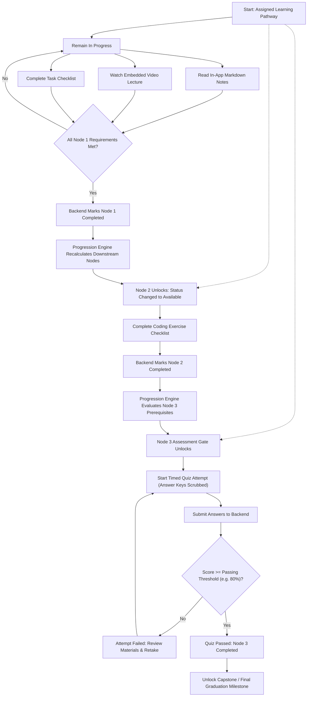
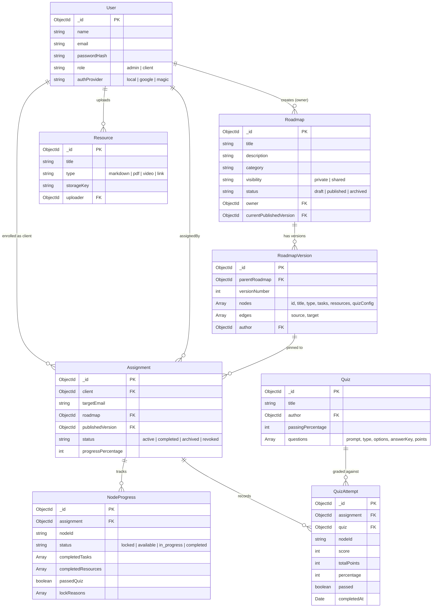

# Pathfinder

> **Personalized learning pathways, educator-controlled curricula, and server-authoritative mastery progression.**

[](https://mernfinalproject-snowy.vercel.app)
[](https://mernfinalproject-snowy.vercel.app/api/health)
[](https://github.com/thekrishmellow/mernfinalproject)
[](https://nodejs.org)
[](https://www.mongodb.com)

---

## 1. Project Title

**Pathfinder** (Repository: `mernfinalproject` / `personalized-roadmap-platform`)

---

## 2. Tagline

**A full-stack personalized learning pathway engine that empowers educators to design modular roadmaps, enforce prerequisite assessment gates, and guide learners through structured mastery journeys.**

---

## 3. Project Overview

Pathfinder is a full-stack MERN application built to solve the rigidity and fragmentation of modern education platforms. Rather than forcing every student down an identical, static syllabus, Pathfinder enables instructors, mentors, and educational teams to design customized, visual learning roadmaps and assign them to specific learners.

The platform combines an interactive drag-and-drop node canvas (inspired by `roadmap.sh`), a gamified step-by-step milestone trail (inspired by BYJU'S), an assessment engine with automated question extraction, and a server-authoritative progression engine.

### Core Philosophy
> *"Every learner should receive a deliberately designed learning journey, and every educator should have a clear view of how that journey is progressing."*

---

## 4. The Problem

Traditional learning management systems (LMS) and static curriculum repositories suffer from persistent pedagogical and architectural bottlenecks:

1. **One-Size-Fits-All Curricula**: Courses are arranged in linear lists that fail to accommodate varying student backgrounds, pacing, or remediation needs.
2. **Cognitive Overload**: Students presented with large course catalogs often lose sight of their immediate objective, their current milestone, and the path forward.
3. **Scattered Learning Artifacts**: Study resources are fragmented across YouTube videos, local PDF files, external websites, and disparate quiz tools.
4. **Superficial Progression ("Click-Through" Learning)**: Platforms allow students to mark lessons complete without demonstrating comprehension or satisfying prerequisites.
5. **Disconnected Instructor Oversight**: Educators lack a single dashboard that correlates visual curriculum structure with real-time assignment completion and quiz pass rates.
6. **Fragile Draft Edits**: In traditional systems, when an instructor edits an active syllabus, in-flight students experience broken links, altered requirements, or lost progress.

---

## 5. The Solution

Pathfinder addresses these challenges through a unified, prerequisite-driven architecture:

- **Visual Directed Acyclic Graph (DAG) Roadmaps**: Curricula are modeled as directed graphs where nodes represent distinct topics, exercises, or milestone assessments, and edges represent strict prerequisite relationships.
- **Server-Authoritative Progression Invariants**: Downstream nodes remain locked with explicit prerequisite explanations until the backend verifies that all preceding requirements (checklists, resource attestation, and passing quiz thresholds) have been satisfied.
- **Immutable Version Snapshots**: Publishing a roadmap creates an immutable `RoadmapVersion`. Assigned learners are bound to their snapshot, guaranteeing that future instructor drafts never disrupt active students.
- **Centralized Multimedia Workspaces**: Each node encapsulates embedded YouTube videos, GitHub-Flavored Markdown notes, authenticated PDF file previews, and timed quizzes within a distraction-free student workspace.
- **Real-Time Instructor Analytics**: Instructors monitor active assignments, cohort pass percentages, average scores, and recent student activity from an integrated control center.

---

## 6. Key Features

### ✅ Implemented Features (Verified in Codebase)

#### Visual Roadmap Studio & Authoring
- **Interactive Drag-and-Drop Canvas**: Built with `@xyflow/react` (React Flow) featuring custom node types, smoothstep bezier connectors, auto-fit viewports, minimap, and live node search.
- **Node Taxonomy**:
  - `start`: Overview, prerequisites, and orientation.
  - `learning`: Theoretical concepts and reading materials.
  - `practice`: Hands-on coding exercises, assignments, and labs.
  - `quiz`: Gated assessments requiring a minimum passing percentage.
  - `project`: Capstone builds and implementation milestones.
  - `completion`: Curriculum graduation flag.
- **Graph & Cycle Validation**: Backend validation engine (`graphValidationService.js`) enforces DAG integrity using Depth-First Search (DFS) topological sorting to reject circular dependencies, self-loops, and dangling edges.
- **Roadmap Duplication & Drafts**: Instructors can duplicate roadmaps, work in draft mode, and publish version snapshots.

#### Assessment Engine & Question Bank
- **Question Types**: Single-choice (radio), True/False, and Multiple-choice (multi-select).
- **Automated Document Extraction**: Upload PDF, Markdown, or Plaintext study notes. The backend (`documentExtractionService.js`) parses questions, options, and candidate answer keys for instructor review before insertion.
- **Structured CSV / JSON Import**: Fast bulk question import with downloadable templates and row-level validation.
- **Server-Side Grading & Answer Protection**: Answer keys and explanations are stripped from client payloads before quiz attempts are served. Grading and threshold verification happen exclusively on the backend (`quizGradingService.js`).
- **Timed Attempts**: Configurable quiz timers with automatic submission on expiration.

#### Learner Experience & Gamified Milestones
- **Dual Visual Modes**:
  - **Learning Trail (Byju's Style)**: A winding step-by-step milestone path with locked/unlocked stations, progress rings, and celebratory flags.
  - **Knowledge Graph View**: The full relational dependency graph view.
- **Interactive Node Workspace**:
  - Embedded YouTube video player with clean time formatting.
  - GitHub-Flavored Markdown reader with code syntax highlighting and table formatting.
  - Authenticated PDF previews and secure file downloads.
  - Interactive checklists that recalculate node progress in real time.
  - Dynamic **"Continue to Next Module"** topological navigation upon completion.
- **Explicit Lock Reasons**: Locked nodes display clear reasons (e.g., `Complete prerequisite: "Web Architecture"`).

#### Progression & Access Control
- **Server-Authoritative Progression Engine**: `progressionService.js` evaluates checklist tasks, mandatory resource attestation, and quiz passing scores (`score >= passingPercentage`, default 80%) before marking nodes complete and recursively unlocking downstream nodes.
- **Single & Bulk Client Assignments**: Assign roadmaps to individual students or cohorts with expiring single-use invitation tokens.
- **Role-Based Guards**: Strict middleware separation (`requireAdmin` vs. `requireAuth`) isolating instructor studio controls from learner views.

### 🔮 Planned Features (Conceptual / Future Roadmap)
- **Multi-Parent Student Linkages**: Dedicated "Parent" role allowing guardians read-only oversight of their child's progress.
- **Automated Remediation Nodes**: Dynamic branch generation inserting practice modules when a learner fails an assessment.
- **In-App Direct Code Execution**: Sandboxed code execution runner for browser-based programming assignments.
- **Webhook & LMS Integrations**: LTI 1.3 / SCORM export to integrate with Canvas, Blackboard, or Google Classroom.

---

## 7. How It Works

Pathfinder enforces a strict prerequisite-driven learning journey. The workflow below illustrates how a learner progresses from an initial node through an assessment gate to unlock subsequent learning modules:



---

## 8. System Architecture

The application is structured as a decoupled full-stack architecture with a React Single-Page Application (SPA) frontend, an Express.js REST API backend, and a MongoDB persistence layer.

```mermaid
graph TB
    subgraph ClientLayer["Frontend Client (React 18 + Vite)"]
        UI["Tailwind CSS + Lucide Icons"]
        Canvas["Roadmap Studio (@xyflow/react)"]
        Trail["Byju's Milestone Track"]
        Workspace["Node Workspace (Markdown + Video + Quiz)"]
        AuthContext["Auth Context & Token Bootstrapping"]
        ErrorBoundary["Global Error Boundary"]
    end

    subgraph APILayer["Backend Server (Express.js REST API)"]
        RateLimit["Rate Limiting & Helmet Security"]
        AuthMiddleware["JWT & Cookie Authentication Middleware"]
        RoleGuard["Role Boundary Guard (Admin vs Client)"]
        
        subgraph Controllers["Route Controllers"]
            AuthCtrl["Auth & Invitations"]
            RoadmapCtrl["Roadmap & Version Studio"]
            ClientCtrl["Client Learning Workspace"]
            QuizCtrl["Quiz & Question Bank"]
            ResourceCtrl["Resource Library"]
            AnalyticsCtrl["Admin Analytics"]
        end

        subgraph CoreServices["Domain Services"]
            GraphVal["graphValidationService (DFS Cycle Check)"]
            ProgEngine["progressionService (Gated Unlocking)"]
            QuizEngine["quizGradingService (Scrubbed Scoring)"]
            DocExtract["documentExtractionService (PDF/Text Parser)"]
            Storage["storageService (GridFS / Local Disk)"]
        end
    end

    subgraph DataLayer["Persistence Layer"]
        Atlas[("MongoDB Atlas / In-Memory Server")]
        GridFS[("GridFS Bucket: Cloud Uploads")]
    end

    ClientLayer -->|HTTPS REST / JSON| RateLimit
    RateLimit --> AuthMiddleware
    AuthMiddleware --> RoleGuard
    RoleGuard --> Controllers
    Controllers --> CoreServices
    CoreServices --> DataLayer
```



---

## 9. Technology Stack

### Frontend Client
| Technology | Version | Purpose in Platform |
| :--- | :--- | :--- |
| **React** | `^18.3.1` | Core declarative component UI library. |
| **Vite** | `^6.0.7` | High-performance build tool and ESM dev server. |
| **React Router DOM** | `^6.28.1` | Client-side routing with role-protected route guards. |
| **@xyflow/react** | `^12.4.2` | Interactive node-based graph canvas (React Flow). |
| **Tailwind CSS** | `^3.4.17` | Utility-first styling with custom dark-mode aesthetics. |
| **Lucide React** | `^0.474.0` | Clean, modern iconography throughout the UI. |
| **React Markdown** | `^9.0.3` | In-app rendering of study notes with GFM table support. |
| **Axios** | `^1.7.9` | HTTP client with cookie interceptors and error handling. |
| **canvas-confetti** | `^1.9.4` | Milestone completion celebration animations. |

### Backend API
| Technology | Version | Purpose in Platform |
| :--- | :--- | :--- |
| **Node.js** | `>=18.0.0` | Scalable JavaScript server runtime (ES Modules). |
| **Express.js** | `^4.21.2` | Web application framework for RESTful routing. |
| **MongoDB / Mongoose** | `^8.9.5` | ODM for structured schema modeling and validation. |
| **mongodb-memory-server** | `^10.1.3` | Automatic zero-configuration in-memory database fallback. |
| **jsonwebtoken** | `^9.0.2` | Signed JWT session token generation and verification. |
| **bcryptjs** | `^3.0.2` | Salted password hashing (cost factor 12). |
| **Zod** | `^3.24.2` | Strict runtime request schema validation. |
| **pdf-parse** | `^1.1.1` | Buffer-level text extraction from uploaded PDF documents. |
| **multer** | `^1.4.5-lts.1` | Multipart/form-data handler for file and document uploads. |
| **Helmet & Rate Limit** | `^8.0.0` / `^7.5.0` | HTTP security headers and brute-force request limiting. |

### Testing & Infrastructure
| Tool | Version | Purpose |
| :--- | :--- | :--- |
| **Vitest** | `^3.0.5` | Fast ESM unit and integration testing engine. |
| **Supertest** | `^7.0.0` | End-to-end HTTP endpoint integration assertions. |
| **Vercel** | Serverless | Production static hosting and serverless API execution. |

---

## 10. Repository Structure

```text
mernfinalproject/
├── client/                             # Frontend React Single-Page Application
│   ├── src/
│   │   ├── components/                 # Reusable UI primitives and view components
│   │   │   ├── auth/                   # GoogleAuthCard & login forms
│   │   │   ├── landing/                # Interactive product landing sections
│   │   │   ├── layout/                 # Navbar, Sidebar, LearnerNavbar, AppLayout
│   │   │   ├── learner/                # ByjuJourneyTrack, ByjuVideoPlayer, ProgressRing
│   │   │   ├── quizzes/                # QuizModal, ImportQuestionsModal
│   │   │   ├── resources/              # MarkdownViewer, AddYouTubeVideoModal
│   │   │   ├── roadmap/                # RoadmapCanvas, CustomRoadmapNode, NodeConfigPanel
│   │   │   └── ui/                     # ErrorBoundary, Modal, Toast, Button, Badge
│   │   ├── pages/                      # Top-level view routes
│   │   │   ├── admin/                  # AdminDashboard, RoadmapBuilder, AssignmentsPage
│   │   │   ├── auth/                   # LoginPage, RegisterPage, MagicLoginPage
│   │   │   └── client/                 # ClientDashboard, ClientRoadmapView, ClientNodeWorkspace
│   │   ├── services/                   # Axios API service configuration
│   │   ├── state/                      # AuthContext, session management
│   │   ├── utils/                      # Topological roadmap order, YouTube parser
│   │   ├── App.jsx                     # Route definitions, guards, and error boundary
│   │   ├── main.jsx                    # Application entrypoint
│   │   └── index.css                   # Tailwind directives and custom scrollbars
│   ├── package.json
│   └── vite.config.js
├── server/                             # Backend Express REST API
│   ├── src/
│   │   ├── config/                     # Environment loader, MongoDB connection, Storage
│   │   ├── controllers/                # Express controllers (Auth, Roadmap, Client, Quiz)
│   │   ├── middleware/                 # requireAuth, requireAdmin, validateRequest, rateLimiter
│   │   ├── models/                     # Mongoose schemas (User, Roadmap, Assignment, etc.)
│   │   ├── routes/                     # REST routes under /api/v1
│   │   ├── services/                   # Progression engine, graph validator, quiz grader
│   │   ├── utils/                      # Database seeder (seed.js) & crypto tokens
│   │   ├── validators/                 # Zod validation schemas
│   │   ├── app.js                      # Express middleware setup
│   │   └── server.js                   # Local server listener
│   ├── tests/                          # Automated test suites
│   │   ├── unit/                       # graphValidation, quizGrading, googleAuth tests
│   │   └── integration/                # apiWorkflow end-to-end integration tests
│   └── package.json
├── api/                                # Vercel serverless function entrypoint
│   └── index.js
├── shared/                             # Constants shared across packages
│   └── constants/                      # Roles, statuses, node categories, question types
├── .env.example                        # Documented environment variable template
├── docker-compose.yml                  # Local MongoDB container configuration
├── vercel.json                         # Vercel deployment routing and rewrites
└── package.json                        # Root npm workspaces configuration
```

---

## 11. Getting Started

### Prerequisites
- **Node.js**: `v18.0.0` or higher (verified on Node `v24`)
- **npm**: `v9.0.0` or higher
- **MongoDB** *(Optional)*: If no MongoDB URI is supplied, the server automatically starts an in-memory MongoDB instance (`mongodb-memory-server`) for zero-configuration evaluation.

### 1. Clone the Repository
```bash
git clone https://github.com/thekrishmellow/mernfinalproject.git
cd mernfinalproject
```

### 2. Install Dependencies
Install dependencies across both client and server workspaces from the root directory:
```bash
npm install
```

### 3. Configure Environment Variables
Copy the sanitized template file to create your local `.env`:
```bash
cp .env.example .env
```
*(Review Section 12 for configuration details).*

### 4. Run Development Servers
Start both the Express API and the Vite frontend concurrently:
```bash
npm run dev
```

Alternatively, run each service independently in separate terminals:
```bash
# Terminal 1: Backend API (runs on http://localhost:5001)
npm run dev:server

# Terminal 2: Frontend Client (runs on http://localhost:5173)
npm run dev:client
```

### 5. Access the Platform
- **Frontend Web Application**: [http://localhost:5173](http://localhost:5173)
- **Backend API Base**: [http://localhost:5001/api/v1](http://localhost:5001/api/v1)
- **API Health Check**: [http://localhost:5001/api/health](http://localhost:5001/api/health)

---

## 12. Environment Variables

The project uses environment variables to configure ports, database connections, secrets, and third-party services. Store these in a `.env` file at the repository root.

| Variable | Description | Default / Example | Required? |
| :--- | :--- | :--- | :---: |
| `PORT` | Backend HTTP listening port. | `5001` | Optional |
| `NODE_ENV` | Environment mode (`development` or `production`). | `development` | Optional |
| `CLIENT_URL` | Base URL of the client frontend for CORS and redirects. | `http://localhost:5173` | **Required** |
| `MONGO_URI` | MongoDB connection string. If omitted, starts in-memory DB. | `mongodb://localhost:27017/pathfinder` | Optional |
| `JWT_SECRET` | Secret key used to sign and verify JWT session tokens. | *32+ character random string* | **Required** |
| `JWT_EXPIRES_IN` | Duration before issued JWT tokens expire. | `7d` | Optional |
| `COOKIE_SECRET` | Secret key used to sign session cookies. | *Random string* | **Required** |
| `STORAGE_ADAPTER` | Storage provider (`local` or `gridfs`). | `gridfs` (cloud) / `local` | Optional |
| `UPLOAD_DIR` | Directory for local file storage fallback. | `./uploads` | Optional |
| `MAX_FILE_SIZE_MB` | Maximum permitted file upload size in megabytes. | `15` | Optional |
| `ADMIN_EMAIL` | Bootstrap administrator account email. | `admin@roadmap.local` | Optional |
| `ADMIN_PASSWORD` | Bootstrap administrator account password. | `Admin@123456!` | Optional |
| `EMAIL_PROVIDER` | Email provider (`development` or `smtp`). | `development` | Optional |
| `SMTP_HOST` / `PORT` | SMTP server settings for transactional invitation emails. | `smtp.gmail.com` / `587` | Optional |
| `SMTP_USER` / `PASS` | SMTP authentication credentials. | *(Your credentials)* | Optional |
| `VITE_GOOGLE_CLIENT_ID`| Google Cloud OAuth 2.0 Client ID for native popup login. | *(Your Google Client ID)* | Optional |

---

## 13. Application Workflow

### Step 1: Educator Creates a Learning Pathway
1. The instructor signs in (`admin@roadmap.local`) and enters the **Admin Studio**.
2. Using the **Roadmap Builder**, they drag node templates onto the canvas (`start`, `learning`, `practice`, `quiz`, `project`, `completion`).
3. Connecting nodes with edges defines prerequisite dependencies. The backend evaluates DFS graph traversal to guarantee DAG compliance.
4. The instructor attaches learning resources (embedded YouTube videos, Markdown notes, or uploaded PDFs) and links assessment quizzes.
5. The instructor clicks **Publish**. The backend generates an immutable `RoadmapVersion` snapshot.

### Step 2: Distribution & Assignment
1. The instructor navigates to **Assignments** and assigns the published roadmap to an existing student or invites a new student via email.
2. The system creates an `Assignment` and initializes `NodeProgress` records:
   - Root nodes (no incoming edges) are set to `available`.
   - Downstream nodes are set to `locked` with descriptive `lockReasons`.

### Step 3: Learner Progresses Through the Pathway
1. The learner signs in (`alex@learner.local`) and sees their assigned roadmap on the **Client Dashboard**.
2. Opening the path displays the **Learning Milestones Trail**.
3. The learner enters an available node workspace, completes the task checklist, attests learning materials, and completes the gated assessment quiz.
4. Upon meeting all completion conditions, the backend transitions the node to `completed`.
5. The progression engine recursively evaluates downstream locked nodes using an **AND rule**: when all incoming prerequisites are completed, the downstream station unlocks automatically.

---

## 14. Data Model

Pathfinder models relationships across users, curriculum graph snapshots, student assignments, and quiz attempts:



---

## 15. API Documentation

All application endpoints are served under `/api/v1` and return standardized JSON responses:

```json
{
  "success": true,
  "data": {},
  "message": "Optional status message"
}
```

### Core API Endpoints

| Method | Endpoint | Description | Auth Required | Request Body / Parameters |
| :--- | :--- | :--- | :---: | :--- |
| `GET` | `/api/health` | Healthcheck and server status. | None | None |
| `POST` | `/api/v1/auth/google` | Google OAuth / Direct personal authentication. | None | `{ role, profile }` |
| `POST` | `/api/v1/auth/register` | Register a new user account. | None | `{ name, email, password, role }` |
| `POST` | `/api/v1/auth/login` | Sign in with email and password. | None | `{ email, password }` |
| `POST` | `/api/v1/auth/logout` | Clear HTTP-only session cookie. | None | None |
| `GET` | `/api/v1/auth/me` | Fetch authenticated user profile. | `requireAuth` | None |
| `GET` | `/api/v1/admin/roadmaps` | List roadmaps created by instructor. | `requireAdmin`| Query: `?status=&search=` |
| `POST` | `/api/v1/admin/roadmaps` | Create a new roadmap container. | `requireAdmin`| `{ title, description, category }` |
| `PUT` | `/api/v1/admin/roadmaps/:id/draft` | Save canvas nodes, edges, and config. | `requireAdmin`| `{ nodes, edges }` |
| `POST` | `/api/v1/admin/roadmaps/:id/publish` | Validate DAG & publish version snapshot. | `requireAdmin`| `{ publicationNotes }` |
| `POST` | `/api/v1/assignments` | Assign published roadmap to client. | `requireAdmin`| `{ roadmapId, clientEmail }` |
| `POST` | `/api/v1/assignments/bulk` | Bulk assign roadmap to multiple emails. | `requireAdmin`| `{ roadmapId, clientEmails: [] }` |
| `GET` | `/api/v1/client/dashboard` | Fetch student assignments & statistics. | `requireAuth` | None |
| `GET` | `/api/v1/client/assignments/:id/roadmap` | Fetch roadmap view with node statuses. | `requireAuth` | Param: `assignmentId` |
| `GET` | `/api/v1/client/assignments/:id/nodes/:nodeId` | Enter node workspace (enforces lock gate). | `requireAuth` | Params: `assignmentId`, `nodeId` |
| `POST` | `/api/v1/client/assignments/:id/nodes/:nodeId/tasks/:taskId/complete` | Toggle checklist task completion. | `requireAuth` | `{ isCompleted: boolean }` |
| `POST` | `/api/v1/client/assignments/:id/nodes/:nodeId/quiz/start` | Start timed assessment (answers stripped).| `requireAuth` | None |
| `POST` | `/api/v1/client/assignments/:id/nodes/:nodeId/quiz/attempts/:attemptId/submit` | Submit answers for server grading. | `requireAuth` | `{ answers: [] }` |
| `GET` | `/api/v1/resources/:id/download` | Stream protected PDF/file resource. | `requireAuth` | Param: `resourceId` |
| `GET` | `/api/v1/analytics/dashboard` | Cohort pass rates and active assignments.| `requireAdmin`| None |

---

## 16. Authentication and Permissions

### Role-Based Access Control (RBAC)
Pathfinder defines two distinct user roles in [`shared/constants/index.js`](file:///Users/krishnabhatia/mernfinalproject/shared/constants/index.js):

| Role | Intended Users | Capabilities & Permissions |
| :--- | :--- | :--- |
| `admin` | Instructors, Mentors, Teachers, Parents | Access to the **Admin Studio**, Visual Roadmap Builder, Question Bank, Document Question Extraction, Assignment Creation, and Cohort Analytics. |
| `client` | Students, Learners, Trainees, Employees | Access to the **Client Workspace**, Personal Dashboard, Assigned Learning Trails, Multimedia Content, Checklists, and Quiz Attempts. Protected from accessing `/api/v1/admin/*`. |

### Security Measures
- **HTTP-Only Cookies & Bearer Tokens**: Auth tokens are stored in signed, HTTP-only, SameSite cookies with fallback Bearer token authorization in request headers.
- **Answer Key Masking**: The quiz engine scrubs all answer keys and explanations before transmitting assessment payloads to learners.
- **Direct IDOR Protection**: Learners cannot access nodes or download resources belonging to roadmaps they are not explicitly assigned to.
- **Brute-Force Rate Limiting**: Dedicated rate limiters protect authentication (`authLimiter`) and quiz submission (`quizSubmissionLimiter`) endpoints.

---

## 17. Testing

Pathfinder includes an automated test suite executed via **Vitest** and **Supertest**. Tests run against an isolated in-memory MongoDB server (`mongodb-memory-server`) to ensure reproducible results without external database dependencies.

### Running the Test Suite
```bash
npm test
```

### Verified Test Results (20 / 20 Passing):
- **Graph Invariant Tests (`tests/unit/graphValidation.test.js` - 4 tests)**:
  - Validates valid Directed Acyclic Graphs (DAG).
  - Detects and rejects circular dependency loops (A -> B -> C -> A).
  - Rejects self-referential cycles (A -> A).
  - Rejects dangling edges pointing to non-existent nodes.
- **Assessment Engine Tests (`tests/unit/quizGrading.test.js` - 3 tests)**:
  - Verifies answer keys are scrubbed from learner payloads.
  - Validates 80% passing threshold calculations.
  - Records failed attempts without granting node completion.
- **Timed Quiz & Video Tests (`tests/unit/quizTimerAndVideo.test.js` - 3 tests)**:
  - Enforces quiz attempt expiration when timer runs out.
  - Validates extraction of 11-character YouTube IDs across multiple URL formats.
- **Google OAuth Tests (`tests/unit/googleAuth.test.js` - 3 tests)**:
  - Validates direct registration and login with role propagation.
- **End-to-End Workflow Integration (`tests/integration/apiWorkflow.test.js` - 7 tests)**:
  - Full lifecycle test: Admin registers -> builds roadmap -> publishes version -> assigns to student -> student attempts locked node (returns `403 Forbidden`) -> student completes prerequisite -> downstream module unlocks automatically.

---

## 18. Deployment

Pathfinder is deployed to **Vercel** with a serverless monorepo configuration:

- **Frontend**: Built via `vite build` into `dist/` and served as a high-performance static SPA.
- **Backend**: Managed via [`api/index.js`](file:///Users/krishnabhatia/mernfinalproject/api/index.js) and configured through [`vercel.json`](file:///Users/krishnabhatia/mernfinalproject/vercel.json), routing API calls (`/api/*`) to Express serverless handlers.
- **Database**: Connected to a cloud-hosted MongoDB Atlas cluster.
- **Read-Only Serverless File Protection**: The storage adapter uses `/tmp/uploads` for local disk operations and streams uploads directly to MongoDB GridFS in production.

### Live Production Deployment
- **Production URL**: [https://mernfinalproject-snowy.vercel.app](https://mernfinalproject-snowy.vercel.app)
- **API Health**: [https://mernfinalproject-snowy.vercel.app/api/health](https://mernfinalproject-snowy.vercel.app/api/health)

---

## 19. Real-World Applications

### 1. Personalized Computer Science Education
A coding mentor designs a foundational roadmap (*Web Architecture -> JavaScript Concurrency -> REST APIs -> Database Modeling*). A student who struggles with async programming is gated at the assessment level and provided targeted video resources before unlocking database integration.

### 2. Differentiated Classroom Instruction
A high school teacher assigns different pathways to students based on prerequisite diagnostics. Advanced students receive accelerated pathways with capstone project milestones, while students needing reinforcement follow paths with additional prerequisite practice exercises.

### 3. Parent-Supervised Homeschooling
A parent manages a structured weekly learning plan with educational videos and reading checkpoints. The parent reviews completed checklist items and quiz scores without needing to manage complex external spreadsheets.

### 4. Technical Mentorship & Career Preparation
A technical mentor constructs an interview preparation path (*Data Structures -> System Design -> Mock Interviews*). The mentee demonstrates mastery at each checkpoint, giving the mentor tangible evidence of readiness for technical roles.

### 5. Corporate Onboarding & Compliance Training
An engineering team builds an onboarding roadmap (*Security Policies -> Git Workflows -> Local Dev Setup -> First Pull Request*). New hires cannot submit PRs until compliance and security checkpoints have been verified by the server.

### 6. Tutoring & Private Coaching
Independent tutors organize distinct student curriculums under a single account. Tutors attach PDF worksheets, evaluate practice milestones, and track student completion dates from a centralized dashboard.

### 7. Intensive Bootcamp Programs
Bootcamp instructors track student progress across complex, multi-week software engineering paths. The admin analytics dashboard identifies students falling behind early, enabling targeted interventions before milestones are missed.

---

## 20. Current Limitations and Roadmap

### Current Limitations
- **Two Concrete Roles**: The platform implements `admin` and `client`. While parents, tutors, and teachers all use the `admin` role, dedicated sub-roles with restricted visibility are not yet separated in the database schema.
- **Static Passing Criteria**: The passing benchmark is currently configured per quiz (default 80%) rather than dynamically adjusting based on previous student attempts.
- **Local Video Storage**: Videos are supported via embedded YouTube links; direct self-hosted multi-gigabyte video streaming is not natively transcoded on the backend.

### Future Roadmap
- [ ] **Multi-Tenant Organizations**: Subdomain-based tenancy for schools, universities, and corporate teams.
- [ ] **Adaptive Remediation Branches**: Automatic insertion of review nodes when a learner fails a quiz attempt multiple times.
- [ ] **In-Browser Code Execution**: WebAssembly / containerized execution runners for evaluating coding submissions directly on the platform.
- [ ] **Automated Email Notifications**: Digest emails sent to instructors and learners when milestones are achieved or assignments are overdue.

---

## 21. Contributing

Contributions to Pathfinder are welcome! To contribute:

1. **Fork the Repository** on GitHub.
2. **Create a Feature Branch**:
   ```bash
   git checkout -b feature/amazing-feature
   ```
3. **Commit Your Changes**:
   ```bash
   git commit -m "feat: add amazing feature"
   ```
4. **Run the Automated Test Suite**:
   ```bash
   npm test
   ```
5. **Push to Your Branch**:
   ```bash
   git push origin feature/amazing-feature
   ```
6. **Open a Pull Request** with a description of your changes and test coverage.

---

## 22. License

No license file was found in the repository at the time of documentation. All rights are reserved by the repository owner. To use, modify, or distribute this software, please obtain explicit permission from the author.

---

## 23. Acknowledgments

Pathfinder is built using open-source tools and libraries:

- [@xyflow/react](https://reactflow.dev/) — Interactive graph canvas for visual roadmap authoring.
- [Tailwind CSS](https://tailwindcss.com/) — Utility-first CSS framework.
- [Lucide Icons](https://lucide.dev/) — Icon design system.
- [Vitest](https://vitest.dev/) — Testing framework for modern JavaScript.
- [roadmap.sh](https://roadmap.sh) — Inspiration for visual learning roadmaps.
- [BYJU'S](https://byjus.com/) — Inspiration for gamified learning milestone tracks.
